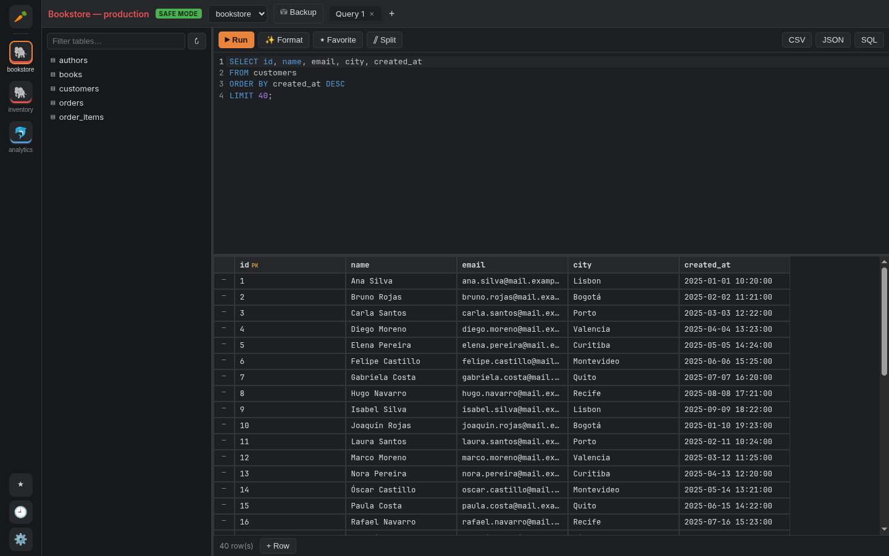
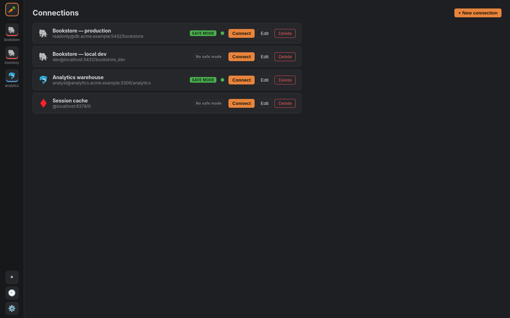
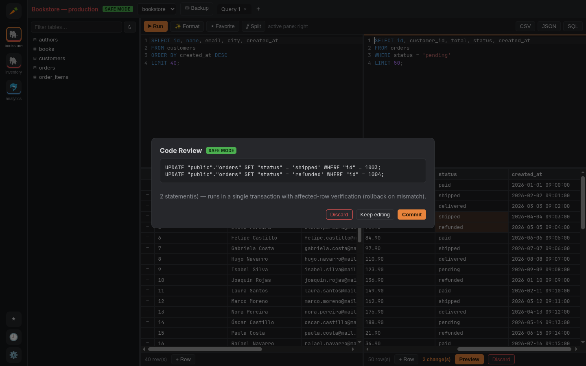
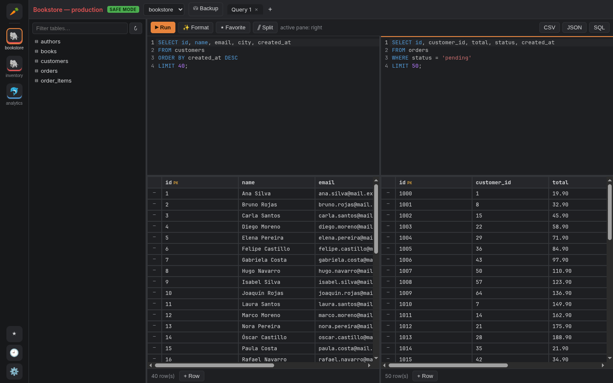
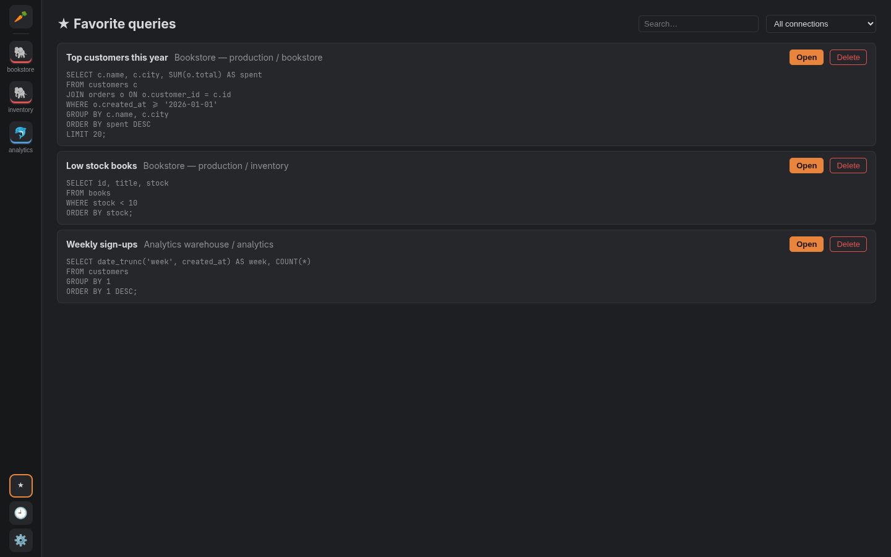
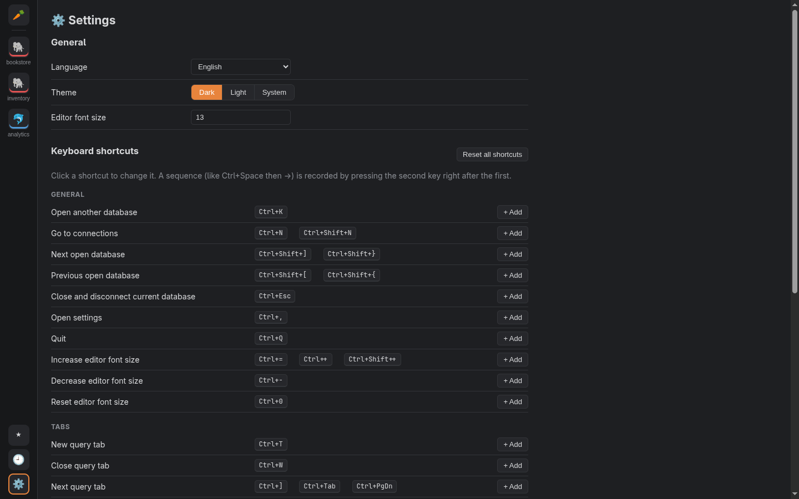
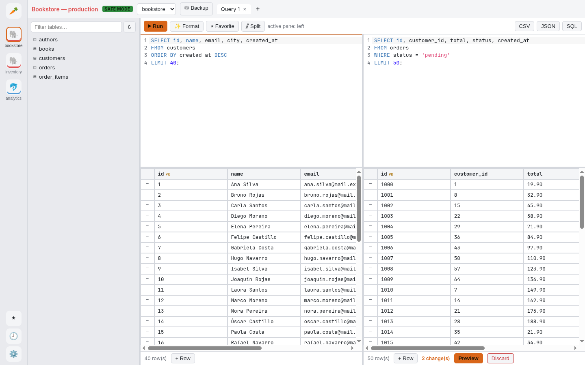

<p align="center">
  
</p>

<h1 align="center">Zanahoria</h1>

<p align="center">
  <a href="README.md">English</a> · <a href="README.pt-BR.md">Português</a> · <b>Español</b>
</p>

<p align="center">
  Un cliente de escritorio rápido y pensado para el teclado, para bases SQL y Redis.<br />
  Hecho con Rust y Tauri para Linux, Windows y macOS.
</p>

<p align="center">
  
</p>

---

Zanahoria te permite conectarte a tus bases de datos, escribir y ejecutar SQL
con un editor inteligente, navegar y editar resultados en una grilla y tener
varias databases abiertas lado a lado. Está pensado para que el trabajo diario
con datos de producción sea más seguro y rápido: los cambios riesgosos pasan
por un paso de revisión, cada edición corre en una transacción y casi todo se
puede hacer desde el teclado.

**Engines soportados:** PostgreSQL · MySQL · MariaDB · SQLite · Redis

## Destacados

- **Varias databases a la vez.** Cada database abierta tiene su propia entrada
  en la barra lateral, con su nombre. Presiona <kbd>Ctrl</kbd>+<kbd>K</kbd>
  para abrir otra database del mismo servidor sin salir de la que estás usando.
- **Safe Mode por conexión.** Marca las conexiones de producción como
  *Safe Mode* y cada cambio hecho desde la grilla se muestra como SQL para
  revisarlo antes de ejecutarlo, se aplica en una sola transacción verificando
  las filas afectadas, y los `UPDATE`/`DELETE` sin `WHERE` piden confirmación.
- **Queries favoritas.** Guarda las queries que usas seguido y vuelve a
  abrirlas desde cualquier conexión, ya apuntando a la database correcta.
- **Vista dividida.** Trabaja en dos queries de la misma pestaña lado a lado,
  cada una con su grilla de resultados. Cambia de panel al estilo tmux con
  <kbd>Ctrl</kbd>+<kbd>Space</kbd> y luego <kbd>←</kbd> / <kbd>→</kbd>.
- **Editor SQL inteligente.** Resaltado de sintaxis, autocompletado según el
  contexto (columnas de las tablas de la sentencia actual, alias, tipos de
  columna), resaltado de la sentencia actual, buscar y reemplazar, y formateo.
- **Grilla de resultados editable.** Navega con las flechas, edita celdas en el
  lugar, agrega o elimina filas, carga más filas bajo demanda y exporta a CSV,
  XLSX (Excel, con números y fechas tipados), JSON o SQL.
- **Filtro de columnas.** En resultados anchos, haz clic en **Filtrar
  columnas** en la barra sobre la grilla y escribe parte del nombre de un
  campo: solo quedan visibles las columnas cuyo nombre lo contiene
  (coincidencia parcial, sin distinguir mayúsculas, como `ILIKE '%texto%'`).
- **Ordenar y filtrar filas.** Haz clic en el encabezado de una columna para
  ordenar las filas cargadas (ascendente → descendente → orden original; los
  NULL al final). Haz clic en **Filtrar filas** para tener una caja de filtro
  bajo cada encabezado: texto simple encuentra las celdas que lo contienen;
  `!texto` lo excluye; `=x`, `!=x`, `>x`, `>=x`, `<x`, `<=x` comparan
  (numéricamente si ambos lados son números); `=null` / `!=null` encuentran
  NULL. Ambos trabajan sobre las filas ya traídas, sin volver a ejecutar la
  query.
- **Mover y redimensionar columnas.** Arrastra el encabezado de una columna
  para moverla; arrastra su borde derecho para cambiar el ancho (doble clic en
  el borde para restaurarlo). El diseño solo aplica al resultado actual y no
  se guarda.
- **Atajos, temas e idiomas personalizables.** Cambia cualquier atajo, elige
  tema oscuro o claro y usa la app en English, Português o Español.
- **Backup y restauración.** Ejecuta `pg_dump`/`pg_restore`/`mysqldump` desde
  la app, o saca una copia consistente de SQLite sin herramientas externas.

## Capturas de pantalla

### Conexiones

Cada conexión muestra si tiene el Safe Mode activado. Un punto verde marca las
conexiones abiertas en este momento.



### Revisión del Safe Mode

Los cambios hechos en la grilla de una conexión con Safe Mode se muestran como
SQL antes de escribir nada.



### Vista dividida

Dos editores, dos grillas de resultados independientes. El panel resaltado es
sobre el que actúan la barra de herramientas y los atajos.



### Queries favoritas



### Configuración y atajos



### Tema claro



## Cómo usarlo

1. **Agrega una conexión.** En la pantalla *Conexiones* haz clic en
   **+ Nueva conexión**, elige el engine y completa host, puerto, usuario,
   contraseña y database (o el archivo, en SQLite). Usa **Probar conexión**
   para verificarla y activa el **Safe Mode** en cualquier database que
   quieras proteger.
2. **Conéctate.** Haz clic en **Conectar**. La database se abre en la barra
   lateral izquierda, con sus tablas en el árbol del schema.
3. **Consulta.** Escribe SQL en el editor y presiona
   <kbd>Ctrl</kbd>+<kbd>Enter</kbd> para ejecutar la selección o la sentencia
   bajo el cursor, o <kbd>Ctrl</kbd>+<kbd>Shift</kbd>+<kbd>Enter</kbd> para
   ejecutar todo. Haz doble clic en una tabla del árbol del schema para ver sus
   datos.
4. **Edita datos.** Haz doble clic en una celda (o selecciónala y presiona
   <kbd>Enter</kbd>), cambia el valor y luego revisa y confirma con
   <kbd>Ctrl</kbd>+<kbd>S</kbd>. Usa **+ Fila** para insertar y **−** para
   eliminar.
5. **Encuentra una columna.** Haz clic en **Filtrar columnas** en la barra
   entre el editor y los resultados y escribe parte del nombre del campo;
   <kbd>Esc</kbd> cierra el filtro y vuelve a mostrar todas las columnas.
6. **Abre más databases.** Presiona <kbd>Ctrl</kbd>+<kbd>K</kbd>, escribe para
   filtrar y presiona <kbd>Enter</kbd>. Haz clic derecho en una entrada de la
   barra lateral para cerrarla.
7. **Guarda favoritas.** Haz clic en **★ Favorita** para guardar la query
   actual; búscala después en la estrella de la barra lateral.

En macOS usa <kbd>⌘</kbd> en lugar de <kbd>Ctrl</kbd>.

## Atajos de teclado

Todos los atajos se pueden cambiar en **Configuración → Atajos de teclado**
(el engranaje al pie de la barra lateral, o <kbd>Ctrl</kbd>+<kbd>,</kbd>).
Estos son los predeterminados:

| Acción | Atajo |
| --- | --- |
| Ejecutar selección o sentencia actual | <kbd>Ctrl</kbd>+<kbd>Enter</kbd> |
| Ejecutar todo el editor | <kbd>Ctrl</kbd>+<kbd>Shift</kbd>+<kbd>Enter</kbd> |
| Volver a ejecutar la última query | <kbd>Ctrl</kbd>+<kbd>R</kbd> / <kbd>F5</kbd> |
| Abrir otra database | <kbd>Ctrl</kbd>+<kbd>K</kbd> |
| Database abierta siguiente / anterior | <kbd>Ctrl</kbd>+<kbd>Shift</kbd>+<kbd>]</kbd> / <kbd>[</kbd> |
| Cerrar y desconectar la database actual | <kbd>Ctrl</kbd>+<kbd>Esc</kbd> (o <kbd>Ctrl</kbd>+<kbd>W</kbd> sin pestañas abiertas) |
| Nueva / cerrar pestaña de query | <kbd>Ctrl</kbd>+<kbd>T</kbd> / <kbd>Ctrl</kbd>+<kbd>W</kbd> |
| Pestaña de query siguiente / anterior | <kbd>Ctrl</kbd>+<kbd>Tab</kbd> / <kbd>Ctrl</kbd>+<kbd>Shift</kbd>+<kbd>Tab</kbd> |
| Dividir / unir el editor | <kbd>Ctrl</kbd>+<kbd>\\</kbd> |
| Enfocar panel izquierdo / derecho | <kbd>Ctrl</kbd>+<kbd>Space</kbd> y luego <kbd>←</kbd> / <kbd>→</kbd> |
| Formatear SQL / compactar en una línea | <kbd>Ctrl</kbd>+<kbd>I</kbd> / <kbd>Ctrl</kbd>+<kbd>Shift</kbd>+<kbd>I</kbd> |
| Comentar línea / bloque | <kbd>Ctrl</kbd>+<kbd>/</kbd> / <kbd>Ctrl</kbd>+<kbd>Alt</kbd>+<kbd>/</kbd> |
| Previsualizar / confirmar cambios pendientes | <kbd>Ctrl</kbd>+<kbd>Shift</kbd>+<kbd>P</kbd> / <kbd>Ctrl</kbd>+<kbd>S</kbd> |
| Tamaño de letra del editor | <kbd>Ctrl</kbd>+<kbd>+</kbd> / <kbd>Ctrl</kbd>+<kbd>-</kbd> / <kbd>Ctrl</kbd>+<kbd>0</kbd> |
| Ir a conexiones / configuración | <kbd>Ctrl</kbd>+<kbd>N</kbd> / <kbd>Ctrl</kbd>+<kbd>,</kbd> |
| Salir | <kbd>Ctrl</kbd>+<kbd>Q</kbd> |

En la grilla de resultados: las flechas, <kbd>Tab</kbd>,
<kbd>Home</kbd>/<kbd>End</kbd> y <kbd>PgUp</kbd>/<kbd>PgDn</kbd> mueven entre
celdas, <kbd>Enter</kbd> o <kbd>F2</kbd> editan y <kbd>Ctrl</kbd>+<kbd>C</kbd>
copia la celda.

## Instalación

Descarga la última versión desde la [página de Releases](../../releases). Se
publica una release nueva automáticamente con cada push a `main`.

### Linux

1. Descarga `Zanahoria_<versión>_amd64.AppImage`.
2. Dale permiso de ejecución y ábrelo:

   ```bash
   chmod +x Zanahoria_*_amd64.AppImage
   ./Zanahoria_*_amd64.AppImage
   ```

### Windows

Descarga y ejecuta `Zanahoria_<versión>_x64-setup.exe` (o el `.msi`). Si
SmartScreen avisa que la app no es reconocida, haz clic en **Más información →
Ejecutar de todas formas**.

### macOS

1. Descarga `Zanahoria_<versión>_universal.dmg` (funciona en Macs con Apple
   Silicon e Intel).
2. Abre el `.dmg` y arrastra **Zanahoria** a **Aplicaciones**.
3. La app no está firmada con un certificado de Apple Developer, así que la
   primera vez macOS la va a bloquear ("Zanahoria está dañado" o "no se puede
   abrir"). Permítela una vez, de una de estas formas:
   - Abre la **Terminal** y ejecuta:

     ```bash
     xattr -cr /Applications/Zanahoria.app
     ```

   - O intenta abrir la app, luego ve a **Ajustes del Sistema → Privacidad y
     seguridad** y haz clic en **Abrir igualmente**.

Después de eso abre normalmente.

### Actualizaciones

En Linux y Windows, al iniciar, Zanahoria revisa la última release de GitHub
y, si hay una más nueva, pregunta antes de instalarla. La AppImage se
reemplaza a sí misma y se reinicia; en Windows el instalador corre en modo
pasivo.

En macOS la app todavía no se actualiza sola: descarga el `.dmg` nuevo,
reemplaza la app en **Aplicaciones** y repite el paso del `xattr`.

## Compilar desde el código

Requisitos:

- [Rust](https://rustup.rs) (stable)
- [Node.js](https://nodejs.org) 22 o más nuevo y [pnpm](https://pnpm.io) 11
- Los [requisitos previos de Tauri](https://v2.tauri.app/start/prerequisites/)
  para tu plataforma (en Debian/Ubuntu: `libwebkit2gtk-4.1-dev`,
  `libappindicator3-dev`, `librsvg2-dev`, `patchelf`)

```bash
pnpm install
pnpm tauri dev     # ejecuta en modo desarrollo
pnpm tauri build   # genera los instaladores en src-tauri/target/release/bundle
```

El script `./dev.sh` hace lo mismo, y `./dev.sh --db` además levanta bases de
prueba locales de PostgreSQL, MySQL, MariaDB y Redis con Docker Compose.

### Tests

```bash
pnpm test                                   # tests unitarios del frontend
cargo test --manifest-path src-tauri/Cargo.toml --workspace
```

Los tests de integración corren contra las bases de Docker Compose cuando
están definidas las variables de entorno `ZANAHORIA_TEST_PG`,
`ZANAHORIA_TEST_MYSQL`, `ZANAHORIA_TEST_MARIADB` y `ZANAHORIA_TEST_REDIS` (ver
`.github/workflows/build.yml`).

## Estructura del proyecto

```
src/                 Frontend React + TypeScript (editor, grilla, configuración, i18n)
src-tauri/           Aplicación Tauri (comandos expuestos al frontend)
src-tauri/crates/
  db-core/           Engines de base de datos, ejecución de queries, schema, mutaciones
  app-store/         Almacenamiento local: conexiones, historial, favoritas, configuración
  backup/            Tareas de backup y restauración (pg_dump, mysqldump, …)
```

Las contraseñas nunca se guardan en la base de la app: quedan en el almacén de
credenciales del sistema operativo (Secret Service, Administrador de
credenciales de Windows o Llavero de macOS), con un archivo cifrado como
respaldo cuando no hay almacén disponible.
